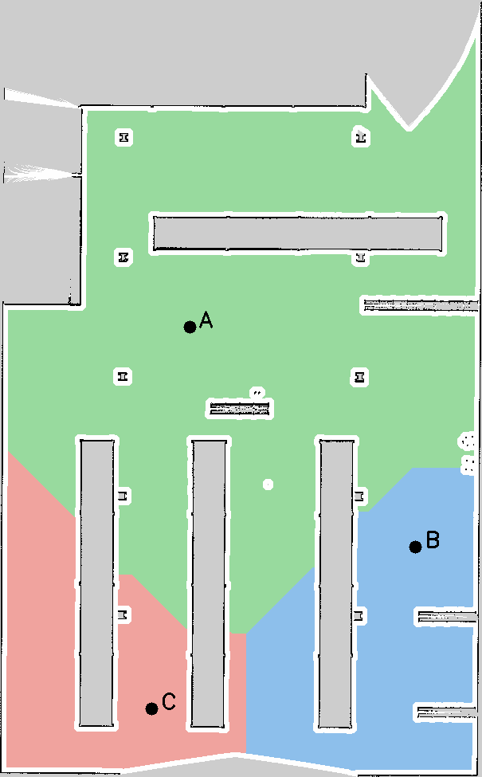

# Bài 7 — Phân vùng bản đồ và điều hướng TurtleBot 4 bằng giọng nói

Hệ thống chia bản đồ Occupancy Grid thành ba vùng A/B/C, gắn tên ngữ nghĩa và nhận câu lệnh tiếng Việt offline bằng Vosk để điều hướng qua Nav2. Hỗ trợ đi qua nhiều điểm, từ chối vùng không tồn tại và hủy hành trình đang chạy.

**Môi trường:** Ubuntu 24.04 · ROS 2 Jazzy · Gazebo Harmonic · TurtleBot 4 · Python 3.12.



## 1. Chức năng và tên vùng

| Vùng | Câu nói nên dùng | Tên thay thế | Đích trong frame map (m) |
| --- | --- | --- | --- |
| A | Đi đến phòng học | Khu vực A, khu vực một | x = −3,158; y = 3,161 |
| B | Đi đến phòng thí nghiệm | Khu vực B, khu vực hai, bê | x = 10,992; y = −10,639 |
| C | Đi đến hành lang | Khu vực C, khu vực ba, xê | x = −5,558; y = −20,789 |

Tên phòng là nhãn gán cho vùng chức năng trên bản đồ kho hàng, không phải kết quả tự nhận biết loại phòng từ ảnh. Nên dùng tên nhiều âm tiết; model Vosk nhỏ từng nhầm âm cuối A/bê/dê/xê.

```text
Micro → PCM16 mono 16 kHz → high-pass 150 Hz → Vosk + grammar
      → /voice_nav/command → parser + regions.yaml
      → NavigateToPose → Nav2 → TurtleBot 4
      → /voice_nav/status và marker RViz
```

## 2. Cấu trúc repository cần giữ

```text
README.md
.gitignore
bai_07_voice_navigation/
├── README.md / requirements.txt
├── map_tools.py / segment_map.py
├── commands.py / navigation_node.py
├── speech.py / voice_input.py
├── maps/                       # Bản đồ gốc, phân vùng và regions.yaml
├── tests/                      # 27 kiểm thử
├── results/                    # Log và kết quả phiên thực tế
├── report_assets/              # Hình trong báo cáo
├── TEST_CASES.md / VALIDATION.md
├── REPORT.md / report.pdf      # Báo cáo ngắn hai trang
├── Bao_cao_chi_tiet_Bai_07.*    # DOC, DOCX, PDF chi tiết
└── package_submission.py       # Đóng gói source sạch
src/
└── tb4_assignment/
    ├── package.xml / CMakeLists.txt
    ├── launch/                 # navigation.launch.py, gz_ogre2.launch.py, ...
    ├── config/                 # nav2_params.yaml, ...
    ├── maps/                   # final_map.pgm và final_map.yaml
    ├── scripts/ / test/
    └── worlds/
```

Chỉ upload `bai_07_voice_navigation/` đủ để đọc source và báo cáo, nhưng thiếu package mô phỏng/Nav2 để chạy lại đầy đủ demo theo hướng dẫn này. Cần đưa thêm `src/tb4_assignment/` và README ở gốc repository.

## 3. Cài đặt trên máy mới

Cài ROS 2 Jazzy và Gazebo Harmonic trước. Clone repository hoặc giải nén source sao cho `~/tb4_slam_ws/src/tb4_assignment/package.xml` tồn tại. Các lệnh chạy từ gốc workspace:

```bash
cd ~/tb4_slam_ws
sudo apt update
sudo apt install \
  python3-venv python3-opencv python3-yaml python3-scipy \
  python3-colcon-common-extensions python3-rosdep curl alsa-utils \
  ros-jazzy-rmw-fastrtps-cpp ros-jazzy-turtlebot4-gz-bringup \
  ros-jazzy-turtlebot4-navigation ros-jazzy-nav2-bringup \
  ros-jazzy-nav2-msgs ros-jazzy-nav2-simple-commander \
  ros-jazzy-visualization-msgs ros-jazzy-cv-bridge ros-jazzy-slam-toolbox

source /opt/ros/jazzy/setup.bash
rosdep update
rosdep install --from-paths src --ignore-src -r -y
colcon build --symlink-install --packages-select tb4_assignment

python3 -m venv --system-site-packages bai_07_voice_navigation/.venv
bai_07_voice_navigation/.venv/bin/python -m pip install \
  -r bai_07_voice_navigation/requirements.txt
```

Nếu chưa khởi tạo rosdep, chạy `sudo rosdep init` một lần trước `rosdep update`. Venv phải dùng Python hệ thống cùng phiên bản với ROS và `--system-site-packages` để thấy rclpy, OpenCV, YAML, SciPy.

**Model tiếng Việt không nằm trong GitHub/ZIP.** Tải một lần sau khi lấy source:

```bash
cd ~/tb4_slam_ws
mkdir -p bai_07_voice_navigation/models
curl -fL https://alphacephei.com/vosk/models/vosk-model-small-vn-0.4.zip \
  -o /tmp/bai07-vosk-vn.zip
python3 -m zipfile -e /tmp/bai07-vosk-vn.zip bai_07_voice_navigation/models
```

Các lệnh ASR bên dưới truyền rõ `--model` vào thư mục vừa tải, nên không phụ thuộc bài 5. Tại workspace cũ, có thể thay bằng `$PWD/bai_05_dialogue/models/vosk-model-small-vn-0.4` để dùng lại model đã có.

## 4. Chạy demo — ba terminal

Dừng phiên ROS/Gazebo/teleop/behavior cũ trước khi mở demo. Mỗi khối đã có đầy đủ thiết lập môi trường.

### Terminal 1 — Gazebo, localization và Nav2

```bash
cd ~/tb4_slam_ws
source /opt/ros/jazzy/setup.bash
source install/setup.bash
export RMW_IMPLEMENTATION=rmw_fastrtps_cpp

ros2 launch tb4_assignment navigation.launch.py auto_undock:=true
```

Chờ robot undock `SUCCEEDED` và lifecycle Nav2 báo `Managed nodes are active`. Launch khởi động Nav2 trễ 25 giây. Kiểm tra robot/scan khớp map; dùng **2D Pose Estimate** trong RViz nếu định vị chưa đúng. Có thể thêm `gui:=false rviz:=false` để chạy không cửa sổ.

### Terminal 2 — node điều hướng

```bash
cd ~/tb4_slam_ws
source /opt/ros/jazzy/setup.bash
source install/setup.bash
export RMW_IMPLEMENTATION=rmw_fastrtps_cpp

python3 bai_07_voice_navigation/navigation_node.py \
  --goal-timeout 300 --ros-args -p use_sim_time:=true
```

### Terminal 3 — nhận giọng nói

```bash
cd ~/tb4_slam_ws
source /opt/ros/jazzy/setup.bash
source install/setup.bash
export RMW_IMPLEMENTATION=rmw_fastrtps_cpp

bai_07_voice_navigation/.venv/bin/python \
  bai_07_voice_navigation/voice_input.py \
  --mic --device pipewire --audio-level --highpass 150 \
  --model "$PWD/bai_07_voice_navigation/models/vosk-model-small-vn-0.4"
```

Chờ **Vosk sẵn sàng**, nói một câu rồi ngừng khoảng 1–2 giây:

1. **Đi đến phòng học.**
2. Chờ Terminal 2 hiện `"state": "SUCCEEDED"`, nói **Đi đến phòng thí nghiệm.**
3. Chờ hoàn thành, nói **Đi đến hành lang.**

Terminal 3 hiện `PARTIAL` là câu tạm thời; chỉ câu cuối `ASR (...)` đủ confidence, không có `[unk]` mới được gửi. Terminal 2 hiện `ROUTE → NAVIGATING → ARRIVED → SUCCEEDED`.

**Dừng đang chạy:** nói **Dừng lại** hoặc **Hủy lệnh**, chờ `CANCELING → STOPPED`. Hủy bằng giọng nói có độ trễ và không thay thế dừng khẩn cấp vật lý. Ctrl+C Terminal 2 cũng gửi hủy trực tiếp.

## 5. Lệnh và cách xử lý

| Câu nói / tình huống | Hành vi |
| --- | --- |
| Đi đến phòng học / phòng thí nghiệm / hành lang | Đến A / B / C |
| Di chuyển từ phòng học đến phòng thí nghiệm | Luôn ghé A trước rồi B, kể cả robot đang nơi khác |
| Đi từ phòng A qua phòng C rồi đến phòng B | A → C → B |
| Đi đến khu vực D | INVALID_COMMAND, không gửi goal |
| Đi từ A đến D | Từ chối cả câu, không đi A trước |
| Lệnh di chuyển mới khi đang bận | BUSY, bỏ lệnh mới |
| Dừng lại / hủy lệnh | Hủy goal và các đích còn lại |
| Nav2 lỗi, từ chối hoặc timeout | Dừng chuỗi, không gửi đích tiếp theo |

Chỉ gửi đích tiếp theo khi đích trước thành công. `ARRIVED A` trong A → B chưa phải hoàn thành chuỗi. `READY` chỉ báo node nạp cấu hình; nếu action server chưa sẵn sàng thì trả `NOT_READY`, không giữ lệnh để tự chạy sau.

## 6. Thử riêng micro và nhập chữ

Đã source môi trường như Terminal 3, chạy chế độ không điều khiển robot:

```bash
bai_07_voice_navigation/.venv/bin/python \
  bai_07_voice_navigation/voice_input.py \
  --mic --device pipewire --listen-only --audio-level --highpass 150 \
  --model "$PWD/bai_07_voice_navigation/models/vosk-model-small-vn-0.4"
```

Thử “Đi đến phòng học” và xem `CHỈ NGHE`. Chọn thiết bị từ `arecord -L`; dùng `wpctl status` xem nguồn micro mặc định. Phát âm thanh qua tai nghe Bluetooth không có nghĩa đang thu micro tai nghe. Gain 65% đã hữu ích trên máy thử, cần chỉnh theo thiết bị thực tế.

- `--highpass 0`: tắt lọc để đối chiếu. Mặc định Butterworth bậc 4, 150 Hz, giữ trạng thái qua chunk; không phục hồi được âm đã clipping.
- `--free-form`: dùng từ vựng mở khi chẩn đoán. Mặc định grammar lấy name/alias từ YAML, giữ `[unk]` và vùng D để từ chối ngoài phạm vi.
- `--min-confidence`: mặc định 0,65, lấy giá trị nhỏ nhất của các từ. Không hạ ngưỡng để chữa méo âm hoặc nhầm vùng.
- `--wav /path/command.wav`: thay micro bằng WAV PCM16 mono, giữ đúng `--model`.

Thử điều hướng bằng bàn phím, giữ Terminal 1 và 2 rồi thay Terminal 3 bằng:

```bash
bai_07_voice_navigation/.venv/bin/python bai_07_voice_navigation/voice_input.py
```

Chế độ chữ không cần model. Kết thúc phiên theo thứ tự Ctrl+C Terminal 3 → Terminal 2 → Terminal 1.

## 7. Bản đồ, nhãn và RViz

```bash
python3 bai_07_voice_navigation/segment_map.py
python3 bai_07_voice_navigation/segment_map.py \
  --map /path/map.yaml --out /path/segmentation --count 3 --clearance 0.35
```

Threshold dùng `negate/free_thresh` trong YAML. Distance transform loại ô sát tường/unknown/biên ảnh; chọn thành phần liên thông lớn nhất rồi chia geodesic Voronoi bằng BFS bốn hướng. Đích nằm sâu trong từng vùng. Đây là phân vùng chức năng, chưa tự phát hiện ranh giới phòng. `labels.png` lưu 0 cho ngoài miền, 1/2/3 cho A/B/C.

Seed thủ công: `--seeds /path/seeds.json`, ví dụ `[[238,410],[521,686],[190,889]]`, gốc ảnh trên trái. Seed phải khác nhau và thuộc miền đủ clearance. Sao lưu alias tùy chỉnh trước khi tạo lại file vùng.

Tâm pixel: `x_local=(u+0.5)*resolution`, `y_local=(H-v-0.5)*resolution`, sau đó xoay/cộng origin. Node kiểm tra hash bản đồ, đích free, clearance và liên thông. Clearance 0,35 m không thay thế footprint/inflation, định vị và planner Nav2.

Đổi map: truyền cùng map cho launch (`map:=/path/map.yaml`) và file vùng cho **cả hai node** (`--regions /path/segmentation/regions.yaml`). Xác lập lại initial pose. Sửa name/alias: khởi động lại Terminal 2 và 3.

Trong RViz: Fixed Frame `map`, thêm MarkerArray `/voice_nav/markers`, durability **Transient Local**. Đường nối marker chỉ minh họa thứ tự đích; xem Path của Nav2 để biết đường tránh vật cản thực tế.

```bash
ros2 topic echo /voice_nav/status
ros2 topic echo /voice_nav/transcript
ros2 action info /navigate_to_pose
```

## 8. Kiểm thử và kết quả

```bash
cd ~/tb4_slam_ws
source /opt/ros/jazzy/setup.bash
python3 -m unittest discover -s bai_07_voice_navigation/tests -v
```

**27/27 kiểm thử đạt:** 14 logic bản đồ/parser, 6 giao tiếp ROS action với fake Nav2 và 7 grammar/confidence/mức âm/bộ lọc. Test action dùng `ROS_DOMAIN_ID=87`, không làm robot đang vận hành di chuyển.

Phiên giọng nói thực tế ghi nhận cả ba tên vùng; tám lượt điều hướng gồm bốn lượt hoàn thành tại A/B và bốn lượt người dùng chủ động hủy. Các lượt C trong snapshot đã bị hủy, chưa có `ARRIVED C`. Không coi hủy là lỗi và không suy ra tỷ lệ ASR từ confidence hay test logic.

Xem [VALIDATION.md](bai_07_voice_navigation/VALIDATION.md), [TEST_CASES.md](bai_07_voice_navigation/TEST_CASES.md) và `results/`. Người dùng xác nhận hệ thống hoạt động; chưa có bộ âm thanh gán nhãn đo WER, ca vật cản động chuẩn hóa hoặc video đính kèm.

## 9. Báo cáo và lỗi đã gặp

- [Word DOC](bai_07_voice_navigation/Bao_cao_chi_tiet_Bai_07.doc), [DOCX](bai_07_voice_navigation/Bao_cao_chi_tiet_Bai_07.docx), [PDF chi tiết](bai_07_voice_navigation/Bao_cao_chi_tiet_Bai_07.pdf): 23 trang, 8 hình, có mục lục, log thật và bảng lỗi/cách khắc phục.
- [PDF ngắn](bai_07_voice_navigation/report.pdf): hai trang theo đề bài; nguồn `REPORT.md`. Bản ngắn lập trong quá trình phát triển; kết quả giọng nói mới nhất nằm trong bản chi tiết và VALIDATION.

| Lỗi đã gặp | Khắc phục |
| --- | --- |
| Venv thiếu pip/yaml/rclpy | Cài python3-venv, --system-site-packages và source ROS |
| Trùng property Node.handle | Dùng self.goal_handle cho action |
| ASR nhận từ không liên quan | Grammar theo lệnh và parser kiểm tra độc lập |
| Tiếng ù / bão hòa | High-pass 150 Hz, giảm gain, theo dõi dBFS/clipping |
| Nhầm A/B/D/C | Dùng tên phòng học/phòng thí nghiệm/hành lang |
| Terminal 2 không hiện thêm | Kiểm tra ASR final, confidence và subscriber |
| Sửa alias chưa có hiệu lực | Khởi động lại cả node ASR và điều hướng |

Tạo lại bản chi tiết bằng `generate_detailed_report.py`, cần python-docx, matplotlib, SciPy, OpenCV, PyYAML; dùng LibreOffice xuất DOC/PDF. Bản ngắn dùng `generate_report.py` với ReportLab. Cập nhật nội dung/kết quả trong mã sinh báo cáo trước khi tạo lại.

## 10. Đưa lên GitHub Public

**Không bắt buộc tạo ZIP.** Có thể upload trực tiếp file/thư mục. Để chạy lại demo đầy đủ, repository cần **README.md + .gitignore + bai_07_voice_navigation/ + src/tb4_assignment/**, giữ cấu trúc ở mục 2.

Tạo gói source sạch:

```bash
cd ~/tb4_slam_ws
python3 bai_07_voice_navigation/package_submission.py
```

Đầu ra: `tb4_voice_navigation_github.zip` ở gốc workspace. Gói chứa source, map, cấu hình Nav2, báo cáo và log minh chứng; bỏ venv/model/cache, build/install/log ROS và các bài khác.

Upload qua trình duyệt:

1. Tạo repository GitHub, chọn **Public**.
2. Giải nén ZIP, mở thư mục `tb4_voice_navigation` bên trong.
3. Chọn **Add file → Upload files**, kéo **nội dung bên trong** lên để `README.md`, `bai_07_voice_navigation/`, `src/` nằm ở gốc repository. Thêm `.gitignore` nếu trình quản lý file đang ẩn file chấm.
4. Kiểm tra cấu trúc rồi lưu thay đổi/commit. Có thể upload nhiều lượt nếu cần.

Upload nguyên ZIP chỉ lưu một tệp nén, không tạo cây source để GitHub hiển thị. ZIP phù hợp làm bản tải về; source nên hiện trực tiếp trong repository.

Nếu dùng Git, chạy trong thư mục source sạch đã giải nén. Với repository Public trống đã tạo, thay tài khoản/repository:

```bash
git init
git add README.md .gitignore bai_07_voice_navigation src
git commit -m "Add TurtleBot 4 semantic map and Vietnamese voice navigation"
git branch -M main
git remote add origin https://github.com/YOUR_USERNAME/YOUR_REPOSITORY.git
git push -u origin main
```

Nếu chưa có Git CLI, cài `sudo apt install git` hoặc upload trình duyệt. Không đưa model/venv/build/install/log lên GitHub. Thêm URL video vào README sau khi quay; hiện chưa có URL video/repository cụ thể được cung cấp.

Tham khảo: [GitHub Upload files](https://docs.github.com/en/repositories/working-with-files/managing-files/adding-a-file-to-a-repository), [Nav2 NavigateToPose Jazzy](https://api.nav2.org/actions/jazzy/navigatetopose.html), [Vosk models](https://alphacephei.com/vosk/models).
