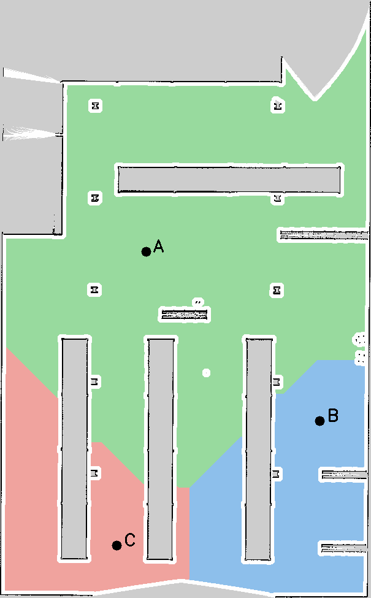

# Bài thực hành 7: Phân vùng bản đồ và điều hướng bằng giọng nói

Môi trường: TurtleBot 4 Simulation, ROS 2 Jazzy, Gazebo Harmonic, Ubuntu 24.04. Ngày kiểm chứng: 06/11/2026.

## 1. Phương pháp phân vùng và gắn nhãn

Bản đồ Occupancy Grid được đọc từ ảnh PGM và YAML của bài SLAM trước. Threshold sử dụng negate/free_thresh của YAML để phân biệt sàn trống; ô chưa biết và vật cản đều bị loại. Distance transform xác định khoảng cách đến vùng không đi được. Với clearance 0,35 m, chương trình chọn thành phần sàn liên thông lớn nhất và chia thành ba vùng chức năng A/B/C bằng geodesic Voronoi: BFS đa nguồn bốn hướng lan từ các seed, không đi xuyên tường. Có thể đặt seed thủ công bằng JSON.

Ảnh kho hàng không có ranh giới phòng đóng rõ ràng; các vùng là vùng chức năng do thuật toán chia, chưa phải kết quả tự nhận dạng phòng học/phòng thí nghiệm. Người dùng có thể đổi tên và thêm alias ngữ nghĩa trong YAML. Tâm đích được chọn sâu trong từng vùng thay vì lấy centroid có thể nằm trong vật cản. Các ô ngoài thành phần chính hoặc sát vật cản giữ nhãn 0.

Đổi tọa độ dùng tâm pixel, đảo trục y của ảnh rồi áp dụng resolution, origin x/y và origin yaw. Với ảnh cao H: local_x=(u+0,5)r; local_y=(H-v-0,5)r. Tọa độ ROS bằng phép xoay local theo yaw rồi cộng origin. File regions.yaml lưu ID, tên, alias, pixel, pose đích, diện tích và hash bản đồ. Node kiểm tra lại clearance, liên thông và hash trước khi nhận lệnh.

---PAGE---

## 2. Nhận dạng giọng nói và điều hướng

Micro ALSA lấy PCM16 mono ở 16 kHz, lọc tiếng ù bằng high-pass 150 Hz; Vosk model tiếng Việt nhỏ chạy offline, giới hạn từ vựng theo mẫu điều hướng/tên vùng và chốt văn bản khi kết thúc câu; [unk] và vùng D được giữ để từ chối câu ngoài phạm vi. Chương trình chỉ gửi câu hoàn chỉnh với confidence nhỏ nhất của các từ từ 0,65 trở lên, không gửi partial. Có chế độ WAV để thử lại âm thanh và chế độ văn bản để chẩn đoán độc lập với ASR.

Parser chuẩn hóa chữ hoa/thường, dấu câu và tiếng Việt có/không dấu. Các mẫu được hỗ trợ: “Đi đến khu vực A”; “Di chuyển từ khu vực A đến khu vực B”; “Đi từ phòng A qua phòng C rồi đến phòng B”. Tên ngữ nghĩa được ánh xạ qua alias. Toàn bộ câu được kiểm tra trước khi gửi bất kỳ goal nào; vùng không tồn tại như D làm từ chối cả hành trình.

ROS node dùng action NavigateToPose trong frame map. Với A → B, node luôn gửi A trước, chỉ gửi B khi A thành công. Nav2 thực hiện lập đường, tránh vật cản và recovery. Khi goal bị từ chối, lỗi, hết thời gian hoặc người dùng nói “dừng lại”, node hủy phần còn lại. Khi đang chạy, lệnh di chuyển mới nhận BUSY; việc hủy phải chờ action kết thúc trước khi mở khóa. Timeout dùng thời gian monotonic, không phụ thuộc đồng hồ mô phỏng. RViz hiển thị tên vùng và đường nối thứ tự đích; đường tránh vật cản thực tế do Nav2 tính.

## 3. Kết quả kiểm thử và giới hạn

Đã tạo bản đồ ba vùng có nhãn cùng YAML đích hợp lệ và ảnh nhãn uint16. Bộ kiểm thử tự động đạt 27/27: 14 test bản đồ/parser, 6 test ROS action với Nav2 giả lập và 7 test grammar/confidence/mức âm thanh/bộ lọc. Các test xác minh tọa độ có origin xoay, ô unknown/vật cản, đích an toàn, thứ tự A → B, vùng không có, lỗi/từ chối goal, BUSY, hủy và timeout. Package ROS build thành công. Model Vosk tiếng Việt nạp được và không trả câu lệnh với PCM im lặng.

Đã chạy Gazebo headless với Nav2 thật: robot undock thành công, nhận câu chữ đi A và đến A sau khoảng 41 giây; lệnh vùng D bị từ chối. Log được lưu trong results. Chưa thử B/C hay vật cản động trên Gazebo. Chưa đo độ chính xác ASR bằng giọng thật, chưa có video và chưa công bố GitHub. Cần thực hiện các ca V01–V04/E08 trong TEST_CASES.md để ghi tỷ lệ nhận đúng, đến đúng và tránh vật cản trước khi nộp.

## 4. Sản phẩm và tài liệu

Source tại bai_07_voice_navigation, bản đồ gốc/phân vùng và regions.yaml tại maps; README có lệnh cài đặt và chạy ba terminal. TEST_CASES.md có kịch bản quay video. Báo cáo này được tạo lại bằng generate_report.py từ REPORT.md. Nav2 action tham khảo: https://api.nav2.org/actions/jazzy/navigatetopose.html. Model Vosk: https://alphacephei.com/vosk/models.
